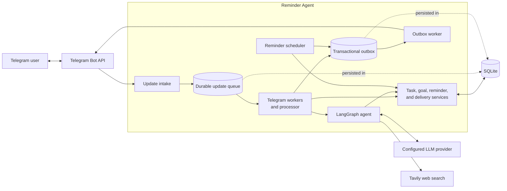

# Reminder Agent

A Telegram bot for creating and delivering AI-assisted reminders.

## Architecture



Incoming Telegram updates are persisted before workers process conversations,
commands, and button callbacks. The agent and direct Telegram actions share the
same domain services, while the scheduler materializes due reminders. Replies
and reminders are written to a transactional outbox, then delivered to Telegram
by a retrying worker.

## Docker setup

You need Docker with Compose, a Telegram bot token, your Telegram user ID, and
credentials for one of the LLM providers listed in `.env.example`.

1. Create the environment file:

   ```bash
   cp .env.example .env
   ```

2. Edit `.env` and configure the following values:

   - Choose and configure one LLM provider.
   - Set `TELEGRAM_BOT_TOKEN` to the token from BotFather.
   - Set `TELEGRAM_OWNER_USER_ID` to your Telegram user ID.
   - Set `DEFAULT_TIMEZONE` to your IANA timezone, such as `Asia/Singapore`.
   - Set `TAVILY_API_KEY` to let the assistant answer questions requiring
     current web information.

The web-search tool is always available. It uses bounded Tavily basic searches
and treats returned content as untrusted evidence. Raw search results are not
retained in durable conversation history.

3. Optional: To reuse an existing local database, stop the locally running
   application, create the database directory, and copy its files. Skip this step
   for a fresh installation; Docker Compose will create the mounted directories.

   ```bash
   mkdir -p docker-data/reminder-agent/db
   cp -a .db/. docker-data/reminder-agent/db/
   ```

4. Build the Docker image from the repository root:

   ```bash
   ./docker-scripts/docker_build_ghcr.sh
   ```

   The script builds `ghcr.io/kelliecsw/reminder-agent` and tags it as both `latest`
   and the current short Git commit.

5. Start the application:

   ```bash
   docker compose -f docker-scripts/docker-compose.yml up -d
   ```

6. Check that it started successfully, then send `/start` to the bot once to link
   the configured owner account to your private Telegram chat:

   ```bash
   docker compose -f docker-scripts/docker-compose.yml ps
   docker compose -f docker-scripts/docker-compose.yml logs -f
   ```

The Compose deployment keeps the database in `docker-data/reminder-agent/db` and
application logs in `docker-data/reminder-agent/logs`. Do not run the local
application and the container simultaneously with the same Telegram bot
configuration.

To stop the application:

```bash
docker compose -f docker-scripts/docker-compose.yml down
```

After changing `.env`, recreate the container so the new values take effect:

```bash
docker compose -f docker-scripts/docker-compose.yml up -d --force-recreate
```

## Development CLI (optional)

The standalone commands remain available for development and isolated testing.
They require [uv](https://docs.astral.sh/uv/) and use a local database.

Start an interactive AI chat:

```bash
uv run python main.py \
  --db dev-agent.db \
  --user-timezone Asia/Singapore \
  chat
```

Run the scheduler in another terminal:

```bash
uv run python main.py \
  --db dev-agent.db \
  --user-timezone Asia/Singapore \
  scheduler
```

Add `--once` to run one materialize-and-deliver cycle and then exit.

Run Telegram polling and delivery as separate development processes after
configuring the Telegram settings in `.env`:

```bash
# Terminal 1: receive Telegram messages, commands, and button callbacks
uv run python main.py \
  --db dev-agent.db \
  --user-timezone Asia/Singapore \
  telegram

# Terminal 2: deliver scheduled reminders through Telegram
uv run python main.py \
  --db dev-agent.db \
  --user-timezone Asia/Singapore \
  scheduler --gateway telegram
```

Both development processes must use the same database. Send `/start` to the bot
once before the first scheduled delivery.
